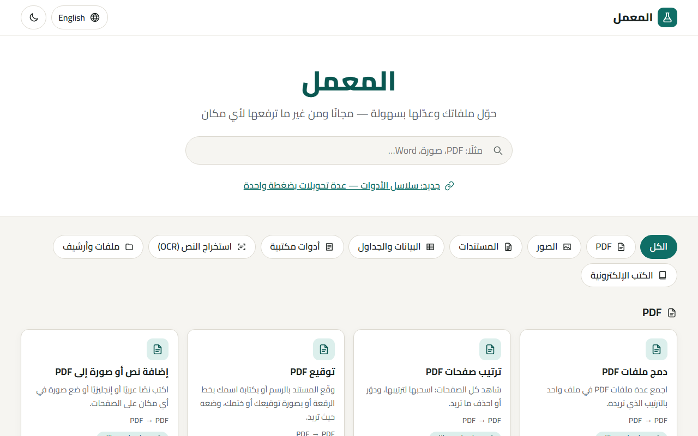
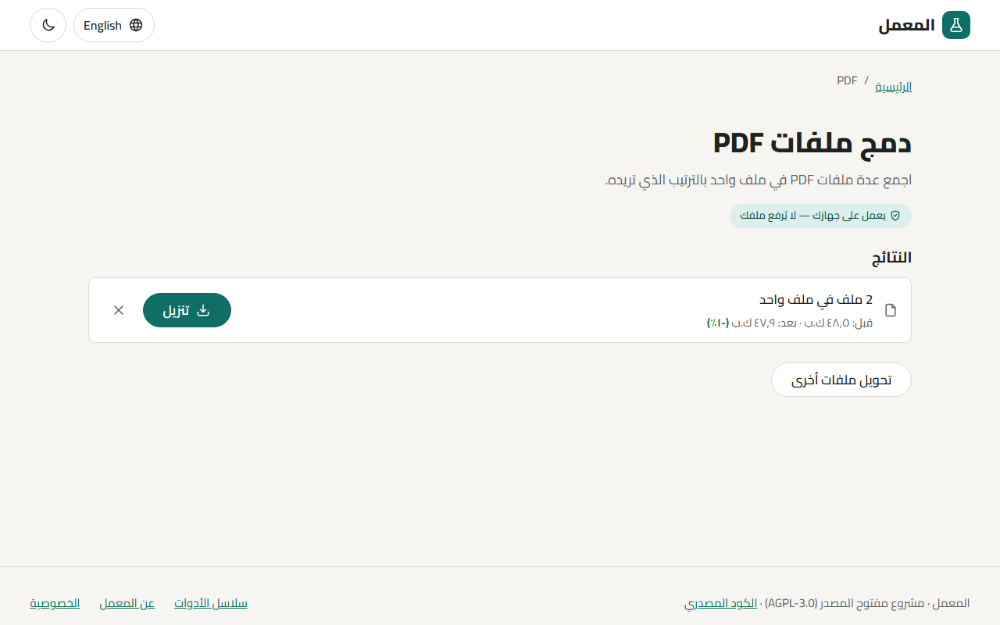
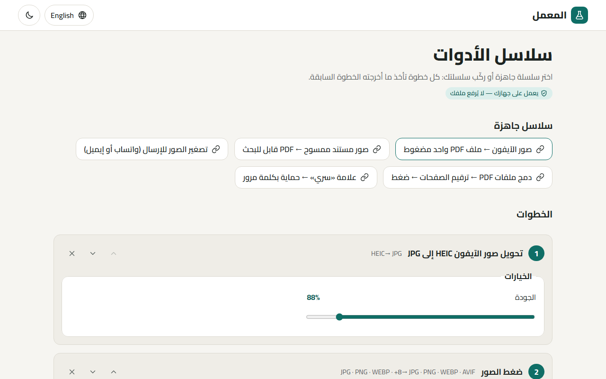
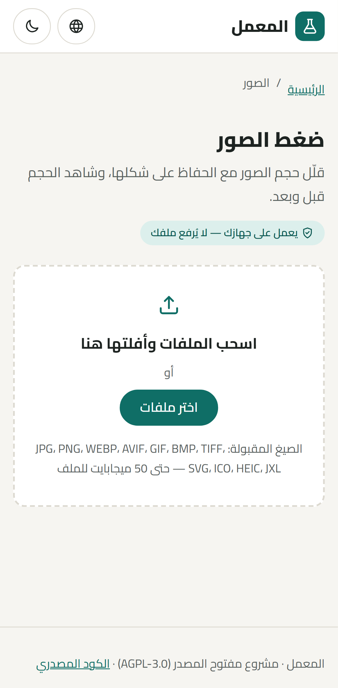
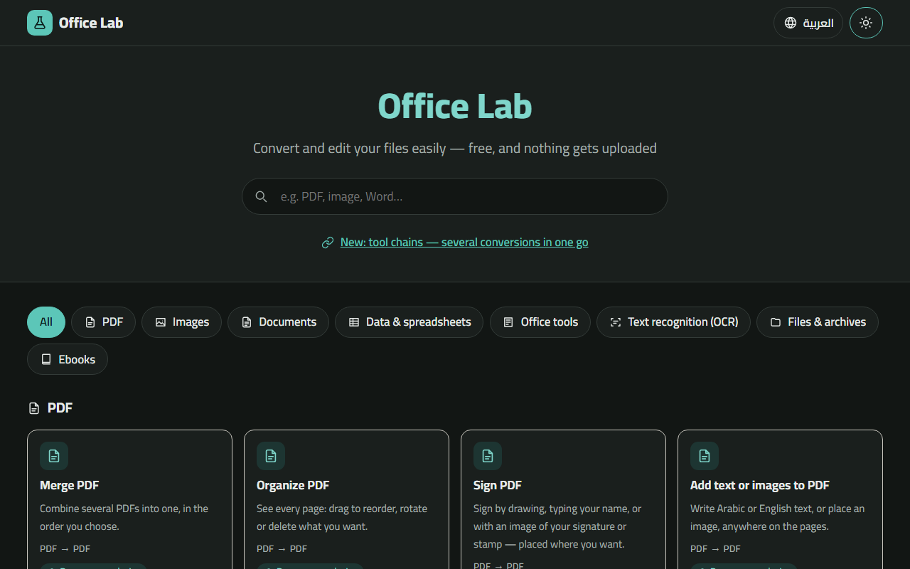

# المعمل · Office Lab

<div dir="rtl">

**المعمل** أدوات مجانية ومفتوحة المصدر لتحويل ملفات المكاتب ومعالجتها: الصور، وPDF، والمستندات، والبيانات.
الأدوات التي تعمل في المتصفح لا ترفع ملفك إلى أي مكان؛ كل شيء يحدث على جهازك.



- **ثبّته كتطبيق** على الكمبيوتر أو الموبايل، ويعمل بدون إنترنت، ويستقبل الملفات من قائمة «مشاركة».
- **سلاسل الأدوات:** عدة تحويلات بضغطة واحدة (مثل صور الآيفون ← JPG ← ضغط ← PDF واحد)، وتحفظ سلسلتك.
- **الصوت والفيديو:** تحويل إلى MP4/MP3، ضغط، قص، كتم، تدوير، فيديو إلى GIF — في المتصفح؛ والملفات الكبيرة والصيغ القديمة (AVI، WMV، AMR…) على الخادم بـ FFmpeg.
- **محادثة واتساب إلى PDF** بالفقاعات والتواريخ والصور، وقابل للبحث.
- **ذكاء اصطناعي على جهازك:** إزالة خلفية الصور وتكبيرها (Real-ESRGAN) بدون رفع.
- **واجهة برمجة (API) بمفاتيح** في نسخة الخادم، موثّقة في صفحة «واجهة البرمجة».
- **النسخة الثابتة (المتصفح فقط):** تُنشر على GitHub Pages — https://micro4tricks-ai.github.io/office-lab/
- **نسخة الخادم (Docker):** للتحويلات الثقيلة (Office ↔ PDF، PDF → Word، الكتب الإلكترونية، OCR للملفات الكبيرة…). التشغيل: `docker compose -f deploy/docker-compose.yml up -d --build` ثم http://localhost — والتركيب على VPS في `deploy/HOSTINGER.md`.

### التشغيل محليًا
</div>

```bash
cd web
npm install
npm run dev
```

<div dir="rtl">

> الحالة الحالية: 101 أداة (81 في المتصفح و20 في نسخة الخادم). راجع `docs/PROGRESS.md` و`docs/FORMATS.md`.

| أداة (دمج PDF) | سلاسل الأدوات | على الموبايل |
|---|---|---|
|  |  |  |

</div>

---

**Office Lab** is a free, open-source toolkit for everyday office files — images, PDF, documents and data.
Browser tools never upload your file: everything runs on your device.



- **Installable app (PWA):** works offline, and receives files from the phone's Share menu.
- **Tool chains:** several conversions in one go (e.g. HEIC → JPG → compress → one PDF), saved as presets.
- **Audio & video:** to MP4/MP3, compress, trim, mute, rotate, video → GIF in the browser (WebCodecs);
  big files and old formats (AVI, WMV, AMR…) on the server with FFmpeg.
- **WhatsApp chat → PDF** with bubbles, dates and photos, searchable.
- **On-device AI:** background removal and upscaling (Real-ESRGAN), nothing uploaded.
- **HTTP API with keys** in the server version, documented on the site's API page.
- **SEO:** a prerendered page per tool and language, sitemap.xml, Open Graph pictures. Every tool and
  format is listed in [`docs/FORMATS.md`](docs/FORMATS.md) (generated from the registry).

- **Static site (browser-only):** deployed to GitHub Pages — https://micro4tricks-ai.github.io/office-lab/
- **Server version (Docker):** heavy conversions (Office ↔ PDF, PDF → Word, ebooks, OCR for long scans…).
  `docker compose -f deploy/docker-compose.yml up -d --build` → http://localhost. VPS guide: `deploy/HOSTINGER.md` (Arabic).

### Run locally

```bash
cd web
npm install
npm run dev            # http://localhost:5173
npm run check          # type check
npx vitest run         # unit tests
npx playwright test    # end-to-end (after a build)
node scripts/make-images.mjs                          # Open Graph pictures + app icons
node scripts/screenshots.mjs http://localhost:4173/   # README screenshots (from a running preview)
```

### Layout

| Path | What |
|---|---|
| `web/` | SvelteKit static site — registry, adapters, workers, i18n |
| `server/` | FastAPI conversion API (Docker image with calibre, pandoc, OCRmyPDF, Ghostscript, qpdf) |
| `deploy/` | docker compose (Caddy + API + Gotenberg), Caddyfile, VPS install script and guide |
| `docs/` | Build spec, progress log, supported formats |
| `.github/workflows/` | CI (build + tests) and GitHub Pages deploy |

### License

[AGPL-3.0](LICENSE).
